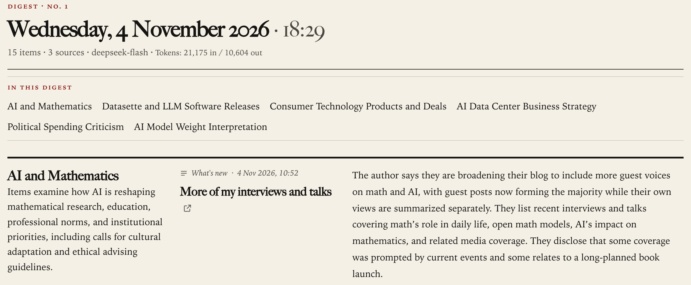
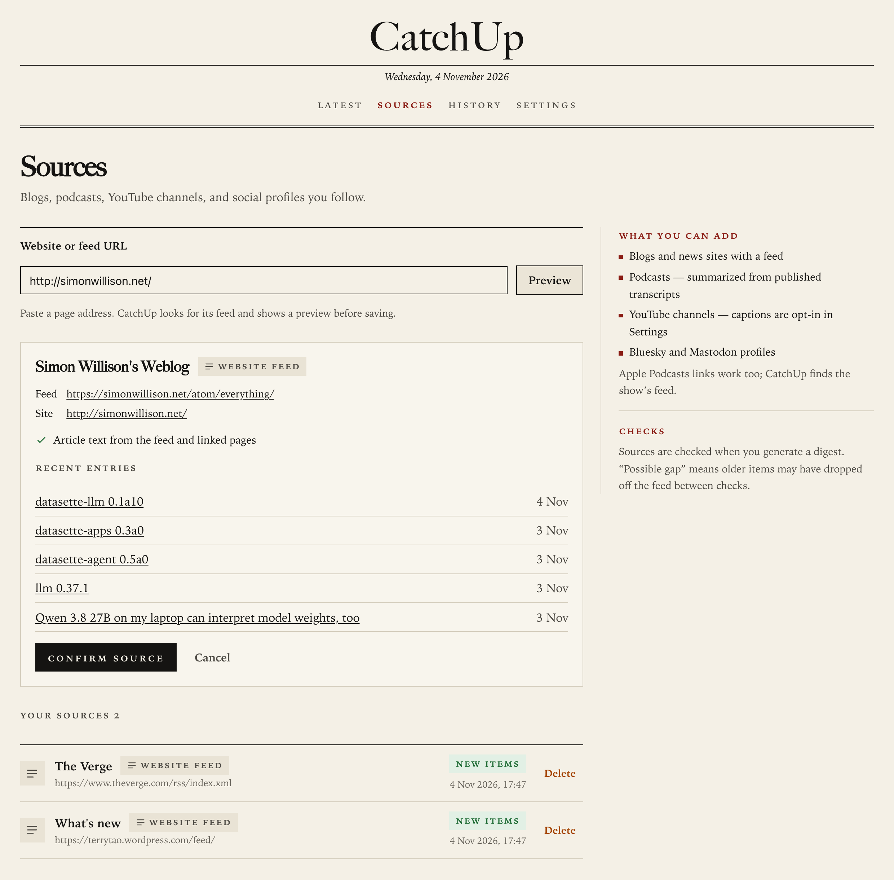
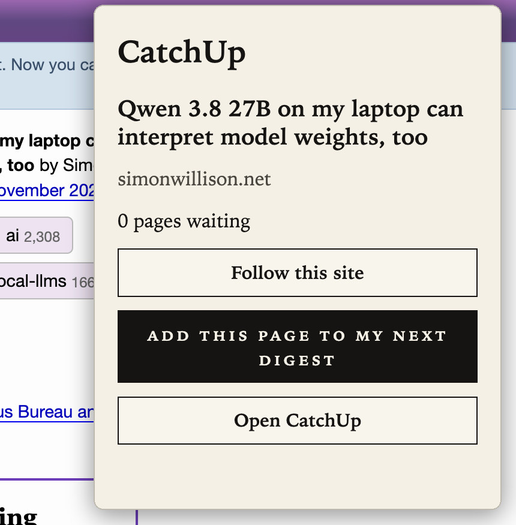
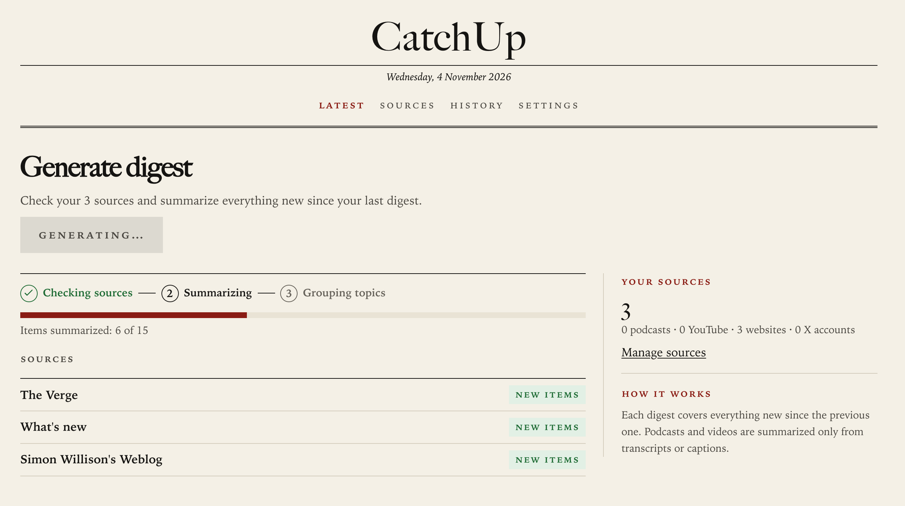
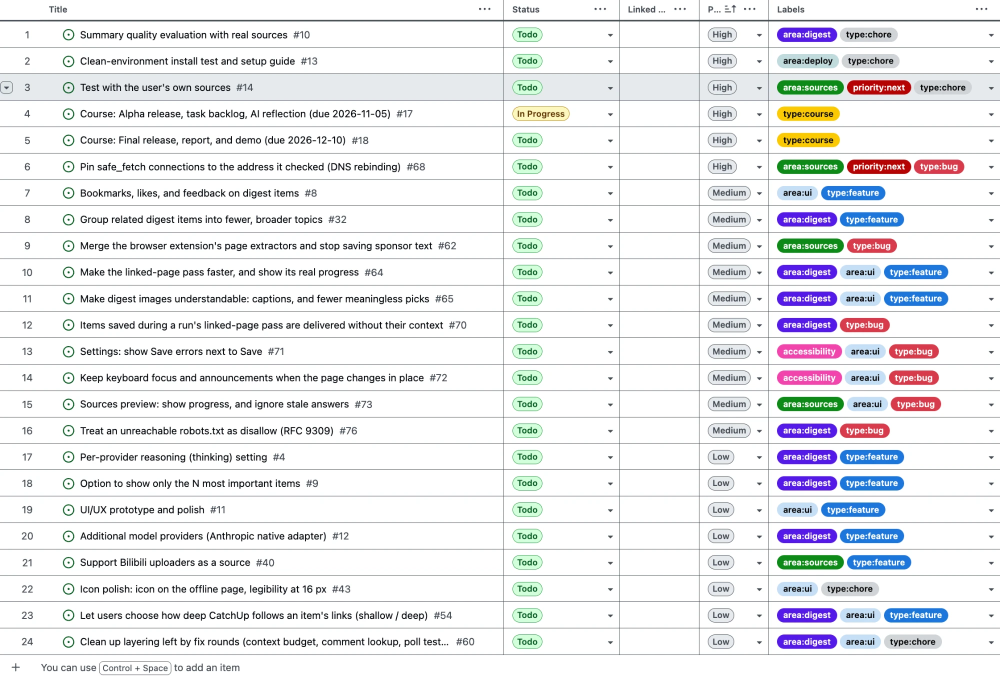

# CatchUp: Alpha Release and Task Backlog

Zhuoang Tao · CS146S Autumn 2026 · 2026-11-05

*Screenshots are from the alpha build (commit `f832bb4`, English digests), cropped for print; larger versions: <https://github.com/Zhuoang2/catchup/blob/main/docs/alpha-release.md>. "#68" means issue or pull request 68; a date in parentheses after an event points to that day's entry in the AI usage log (`docs/process/ai-usage-log.md`).*

## Alpha version

CatchUp is an open-source personal digest that runs on the user's own computer. Users add the sources they follow and connect their own AI model account; **Generate digest** collects everything new since the last check, summarizes and groups it by topic, and links each summary to its original.

The alpha is commit `f832bb4` (2026-11-03); setup is in the README. To run the alpha, build from the checkout with `docker compose up -d --build`; the published `latest` image is still the October release v0.1.0. 885 backend tests (covering 97% of the backend code), 263 web-app and 114 extension tests need no network or model account; the backend, web-app, and Docker checks must pass before any merge. No screen is a placeholder: unbuilt features are tracked as issues.

| Feature | Status | Notes |
|---|---|---|
| Model settings | Functional | Services that accept OpenAI's request format (DeepSeek tested); key stored encrypted. Others not started (#12) |
| Sources: feeds, Bluesky, Mastodon, Reddit, podcasts, X | Functional | Podcasts need a published transcript; X needs the user's own pay-per-use key; Reddit stops its feeds on 2026-11-13 ([TechCrunch](https://techcrunch.com/2026/09/30/reddit-is-killing-rss-feeds-ending-public-api-access-because-of-ai-bots/)) |
| YouTube channels | Best effort | Feeds sometimes fail (one answered 404 on 2026-11-04); YouTube's terms do not allow automated access, so captions are fetched only on opt-in, at the user's risk |
| Digest run, topics, Latest, History | Functional | Topics often too fine-grained (#32); quality not yet measured (#10) |
| Linked pages and author replies | Partial | Slow; the progress bar's total can be several times what a run reads (#64) |
| Images from source sites | Partial | Some chosen images mean little alone (#65) |
| Browser extension | Partial | Chrome and Edge, installed by hand; may save sponsor text (#62) |
| Local install and security | Partial | No user accounts; answers only requests addressed to this computer; refuses changes sent from other websites. Known gaps: #68; image addresses that point into the local network (#65). Clean-machine install test pending (#13) |
| Accessibility | Partial | Contrast and automated checks pass; keyboard focus is lost on some updates (#72) |
| Bookmarks (#8), top-N (#9), link depth (#54), Bilibili (#40) | Not started | |

## Demo

**Latest:** the newest digest, its six topics, and the first summary.

| | |
|---|---|
|  **Sources:** a pasted site is previewed, with its feed and recent entries, before it is saved. |  **Extension:** follow this site, or add this page to the next digest (popup and page captured separately). |
|  | **A run in progress:** the stages, items summarized so far, and a result for each source. |

## Backlog

The backlog is the public issue list (<https://github.com/Zhuoang2/catchup/issues>), organized on a private GitHub Projects board, shown here. Each issue's text is its description, usually what happens, why it matters, and the fix; most issues have type and area labels, and the pull request that implements an issue closes it.

**The project board** (table view): the first 12 of the 24 open tasks (all 6 High and 6 of the 10 Medium) with Title, Status, Priority, and Labels, sorted by priority. The older `priority:next` label predates the Priority field.

On 2026-11-04 the board has 57 items: 23 Todo, 1 In Progress (#17, this document), and 33 Done. The 24 open issues are 6 High, 10 Medium, and 8 Low priority. No assignees are used (one-person team). Not in the screenshot: Medium #71, #72, #73, #76; Low #4, #9, #11, #12, #40, #43, #54, #60. Done tasks have no priority: the field was added on 2026-11-04, after they closed.

The next tasks (their titles are in the board screenshot):

| Issue | Description (plain language) | Status | Priority |
|---|---|---|---|
| [#68](https://github.com/Zhuoang2/catchup/issues/68) | Stop a followed page from making CatchUp read the user's local network (security) | Todo | High |
| [#13](https://github.com/Zhuoang2/catchup/issues/13) | Install on a clean machine using only the README | Todo | High |
| [#10](https://github.com/Zhuoang2/catchup/issues/10) | Measure summary quality on real sources (target: 90% faithful) | Todo | High |
| [#14](https://github.com/Zhuoang2/catchup/issues/14) | Run CatchUp on the sources the author follows, and record the results | Todo | High |
| [#18](https://github.com/Zhuoang2/catchup/issues/18) | Final release, report, and demo, due 2026-12-10 | Todo | High |
| [#70](https://github.com/Zhuoang2/catchup/issues/70) | Pages saved while a run reads linked pages are summarized without their linked pages | Todo | Medium |

## AI tool integration

| Tool | Role |
|---|---|
| Codex | Product discussion and the proposal (2026-10-01) |
| Claude Code (Opus 5.5) | Research, plans, UI prototypes and their design reviews, code reviews, live checks, helper agents |
| Factory Droid (mostly GPT-6 Sol) | Writes the code and tests for most plans, in a separate copy of the repository |

**How the process works.** Context is written once for people and agents: one instruction file for both coding tools (`AGENTS.md`), requirements with 305 example scenarios, and per-change task lists that name each task's test. Every feature or fix is a planned change: for a new feature I choose between two proposals (11 of the 26 changes so far), and a small fix gets a one-step plan. I approve each plan and merge, or a whole overnight queue in advance. After every Droid run the rules require a bug review (`/code-review`) and a helper agent's requirements review. In about five weeks (2026-10-01 to 2026-11-03) this produced 26 planned changes and 28 merged pull requests; all 455 non-merge commits on `main` were co-written by Droid or Claude Code. For scale, once its plan was fixed, Droid built the 14-task interface redesign in about 49 minutes (2026-10-06).

**Successes.**

- **Security bugs caught.** A review found a malicious web page could make CatchUp send it the stored model key, a flaw in Claude's design (2026-10-03); extension research found any website could start a paid run (#59).
- **Plan review.** A fresh helper agent raised 20 problems in the podcast/YouTube plan, 17 confirmed; an unverified second-round item, tested live, showed some Substack newsletters would go unsummarized (2026-10-05).
- **Overnight work.** On 2026-11-03 I wrote, "I'm going to sleep. Arrange tonight's tasks yourself, for example fix the issues that are open now" (translated). Helper agents implemented five small fixes (PRs #78–#82) while Droid's login was expired; a helper agent's review of #67 caught, before the merge, a plan error that would have let a run look successful even when every model call failed.

**Challenges and adjustments.**

- **Passing tests did not prove the behavior.** 147 tests with a simulated model passed, but the first real DeepSeek run left 4 of 11 summaries empty: its step-by-step "thinking" mode, on by default per DeepSeek's documentation, used up the length limit (2026-10-03). Work became test-first (2026-10-07): "write the task's checks as failing tests and watch them fail, then implement until they pass" (prompt for #59, 2026-10-20). A running-app check is also required, but #66 and #67 had their real-model run only after merging (2026-11-04).
- **Fix rounds piled up.** I worried that "one patch is patching another patch" (2026-10-21, translated). Of about 75 fix-round items, 18 were real defects, 6 errors in Claude's plans, about 45 tests added only because a deliberately broken copy of the code still passed them (mutation testing), and 2 needless. We then adopted stop rules: sort findings first, one fix round by default, and a fresh helper agent checks each task list.
- **Plan errors.** Droid stopped twice before coding the redesign: the plan contradicted itself, e.g. a color test the planned colors failed (2026-10-06); the prompt line "stop and report instead of improvising" (since 2026-10-02) kept this cheap; every numeric check in a plan is now computed against the planned values before hand-off.

**Unexpected insights.**

- Most of the 18 real defects were "found by live checks and by reasoning about the code", while mutation testing mostly added test-only checks (decision log, 2026-10-21).
- Plans are cheap to check: a fresh helper agent found 12 false assumptions in the extension plan before coding.
