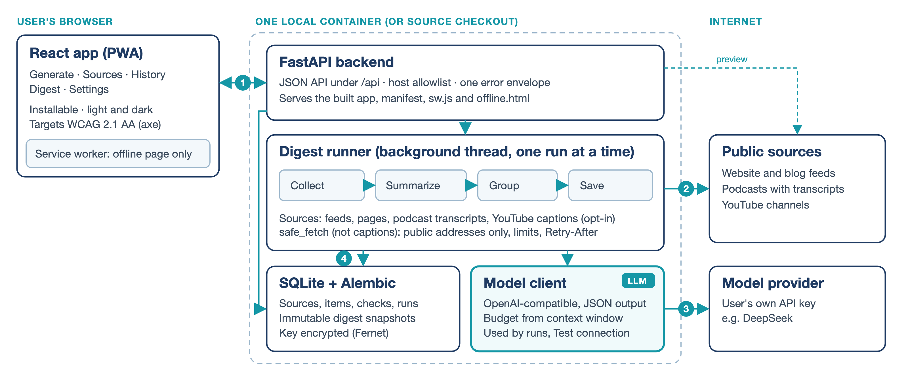

# CatchUp: Technical Specification

Zhuoang Tao · CS146S Autumn 2026 · 2026-10-15

## Architecture

CatchUp is an open-source, self-hosted app: one FastAPI process serves the JSON API and the built React app and stores data in SQLite. It runs from source or as one Docker image on the user's computer, with no central server (D-011).

**Data flow of a digest run** (numbers match the figure).

1. Clicking Generate calls `POST /api/digest-runs`; a background thread runs it while the browser polls.
2. **Collect:** each source is checked through `safe_fetch`; checks and new items are stored in SQLite.
3. **Summarize and group (LLM):** each ready item is summarized from its article text, podcast transcript, or YouTube captions, then grouping calls sort the summaries into topics. Items still lacking a transcript or captions wait (podcasts up to 7 days), then appear once, unsummarized, under "Creator updates".
4. **Save:** the digest is saved as an immutable snapshot and its items are marked delivered in one transaction, so a failed run loses nothing.

**Where the system talks to an LLM.** Only the model client calls the provider (OpenAI-compatible Chat Completions, D-004, with the user's own key): to summarize, group, and list models (for "Test connection" and the context window).

- Calls request JSON output, are sized from the model's context window (long texts are split into chunks), and are tried up to 3 times on `429`, `500`, or `503`.
- Prompts mark source text as data, not instructions, and the model cites items only by reference ID, so titles and links always come from stored data.
- A rejected key fails the run; an item whose summary fails is saved as "summary unavailable".

**Other components.**

- **Fetching:** `safe_fetch` blocks private addresses, re-checks redirects, caps size and time, spaces requests per host, and honors `Retry-After`; opt-in YouTube captions (D-013) only get host spacing.
- **Storage:** SQLite with Alembic migrations; saved digests copy their summaries, titles, and links, so deleting a source never changes them.
- **Security:** no login; by default only `localhost`, `127.0.0.1`, and `[::1]` are served. The key is Fernet-encrypted and shown only as its last four characters; the container runs as non-root.

## API Design

All endpoints are JSON over HTTP under `/api`; errors share one envelope, `{"error": {"code", "message"}}`.

| Endpoint | Input → Output |
|---|---|
| `POST /api/sources/preview` | `{url}` → feed URL, title, kind (feed, podcast, YouTube), recent entries; saves nothing |
| `POST /api/sources` · `GET` · `DELETE /{id}` | `{feed_url}` → saved source (201); list with last check; delete → 204 |
| `POST /api/digest-runs` | → run `{id, status}` (202); `409` if a run is active or no model is set |
| `GET /api/digest-runs/active` · `/{id}` | → status, progress, per-source checks, tokens, saved counts |
| `GET /api/digests` · `/{id}` | → list with topic titles; one snapshot with topics, items, Creator updates |
| `GET`/`PUT /api/settings/model` · `POST …/test` | `{base_url, model_id, api_key}` → settings with `key_set` and last 4; test → model list |
| `GET`/`PUT /api/settings/preferences` | `{digest_language, youtube_captions, youtube_skip_shorts}` → saved preferences |

**External calls.** Preview fetches the page and its feed; adding a source reuses that feed and fetches pages for short new items. A run fetches every source, then calls the LLM; the model test calls the provider. Other endpoints only use SQLite.

## Technical Stack

- **Backend (Python 3.12):** FastAPI, Uvicorn, SQLite with SQLAlchemy 2 and Alembic, Pydantic, httpx; feedparser, trafilatura, lxml, youtube-transcript-api; the OpenAI SDK; `cryptography` (Fernet).
- **Frontend (TypeScript):** React 19, React Router 7, Vite; hand-written CSS, no UI library.
- **Quality and delivery:** pytest (357 tests, 96% coverage); vitest (126 tests, including axe accessibility scans); GitHub Actions with required checks for `backend`, `frontend`, `docker`; a Docker image on GHCR.

## Business Context Summary

Checking many blogs, news sites, podcasts, and video channels one by one takes time. CatchUp collects what is new from the user's chosen sources into an on-demand digest grouped by topic, with links to the originals. Each digest covers everything since the previous one, so a user back after a week sees the whole week at once. Target users are students, developers, and people following industry news or podcasts who can run a local app with their own model key.

**Success metrics.**

| Goal | Metric and target | Current evidence |
|---|---|---|
| Nothing missed or repeated | 100% of new items appear in exactly one digest | Tests: 140-item run, failed run, retries |
| Fast catch-up | A week of 10+ sources digested in under 2 minutes | 7 items in about 20 s (DeepSeek, 13 Oct) |
| Faithful summaries | At least 90% of sampled summaries faithful to the source | Planned evaluation (#10) |
| Affordable | Under 2,000 tokens per summarized item (average) | About 1,200 per item (13 Oct run) |
| Easy to start | Clean Docker install in under 15 minutes | Clean-install test planned (#13) |

## Agent Readiness

- **One context file.** `AGENTS.md` (`CLAUDE.md` links to it) gives Claude Code and Factory Droid, a second coding agent, the same scope, decisions, commands, and rules.
- **Requirements as specs.** OpenSpec holds 8 capabilities and 68 SHALL/MUST requirements with scenarios. Each feature is a change folder (research, two proposals for the user to pick from, an approved `tasks.md` naming the tests); for example, the scenario "Run fails before saving" became task 5.3 and `test_save_failure_rolls_back_snapshot_and_delivery`.
- **Isolation and guardrails.** Droid works in its own git worktree, test-first (`tdd` skill) and reproduce-first for bugs (`diagnosing-bugs` skill, D-016). Tests use a fake model and no network; CI checks are required on `main`; a pre-commit hook blocks staged API keys.
- **Review and evidence.** Every Droid run gets `/code-review` plus an independent sub-agent that checks it against the spec; each finding is verified before any change. A decision log, requirement changes, an AI usage log with real prompts, and a GitHub board record the process.
